# KeepEat

식재료 소비기한 관리와 AI 맞춤 레시피 추천을 연결한 모바일 앱입니다. 2026.03-진행 중.

## 주요 화면

| 로그인 | 냉장고 홈 | OCR 영역 선택 | AI 레시피 생성 |
| --- | --- | --- | --- |
| 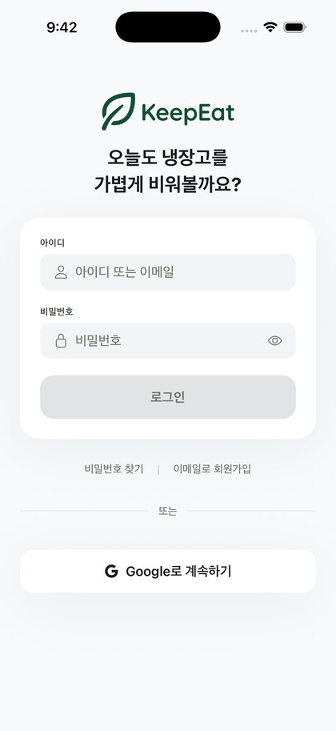 | 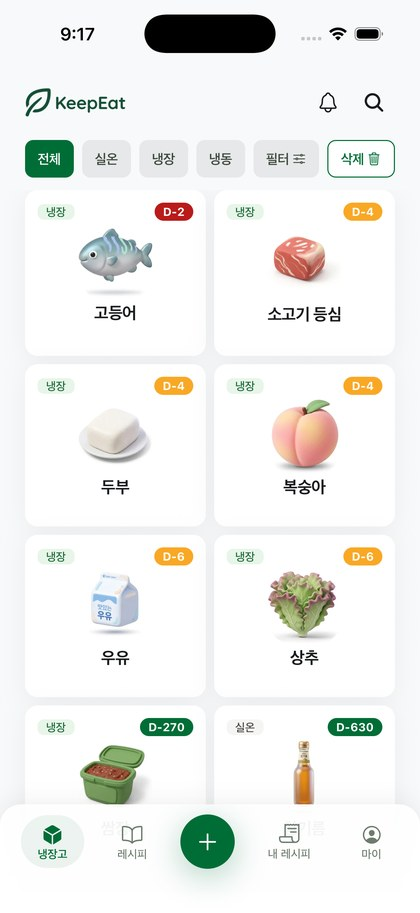 | 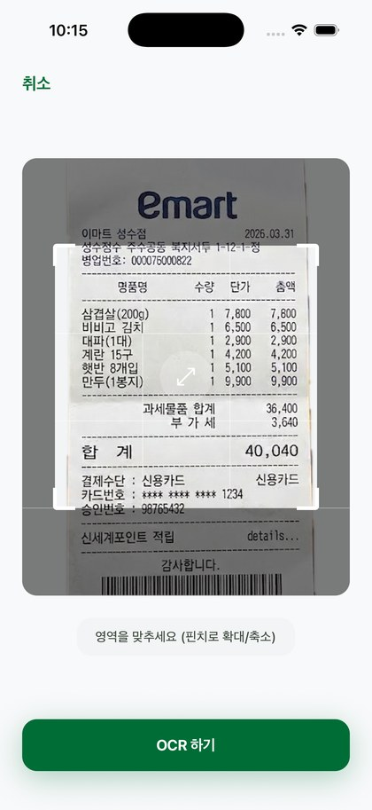 | 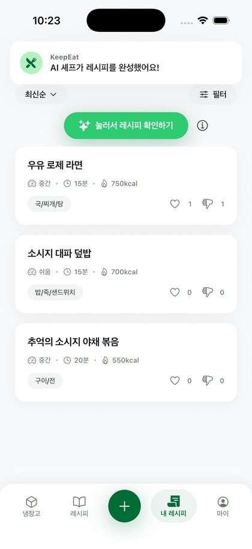 |

## 식재료 등록과 소비기한 관리

| 추가 방식 선택 | 식재료 선택 | 수동 입력 | OCR 결과 확인 |
| --- | --- | --- | --- |
| 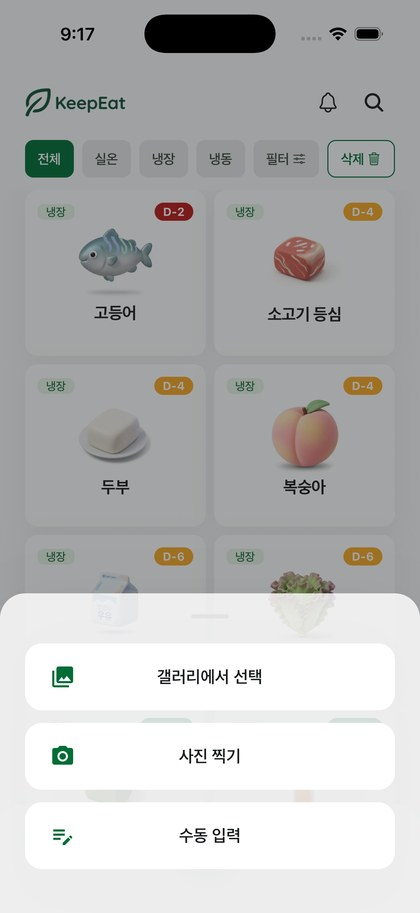 | 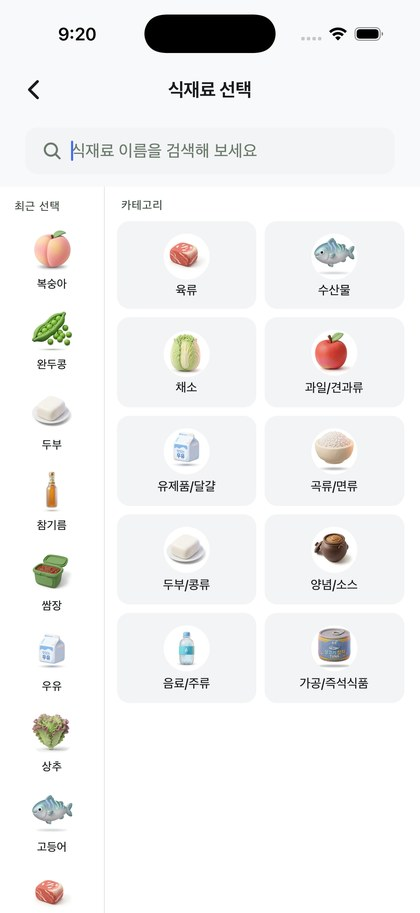 | 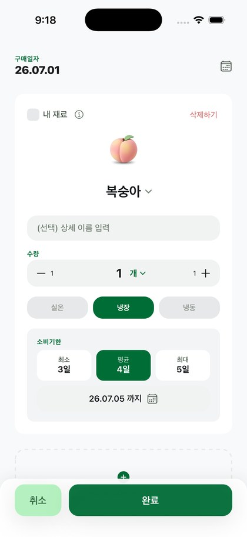 | 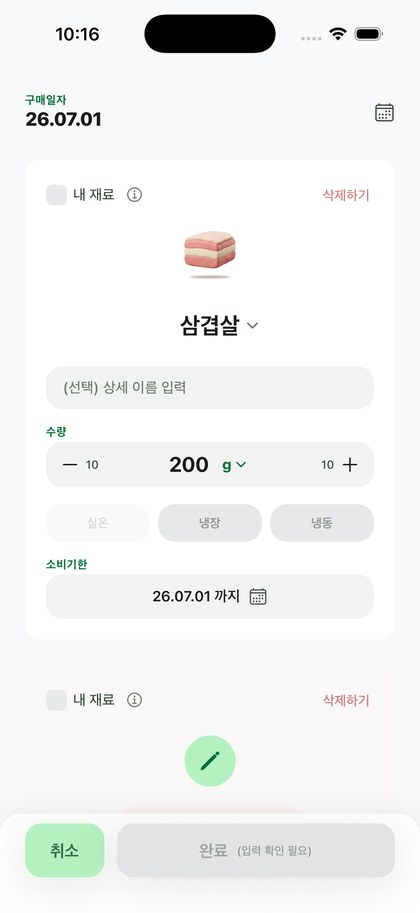 |

| 검색 | 카테고리 필터 | 상세 수정 | 임박 알림 |
| --- | --- | --- | --- |
| 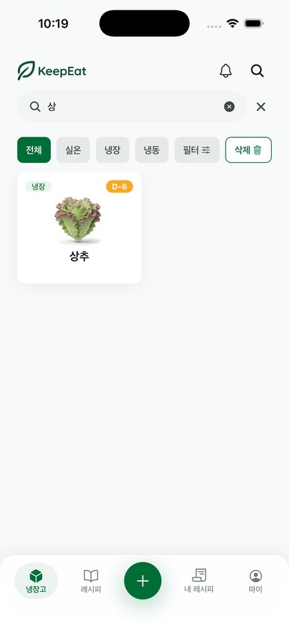 | 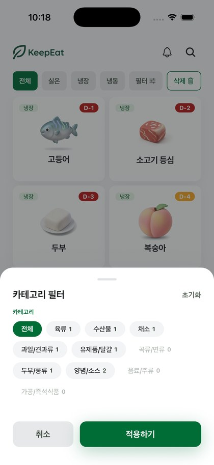 | 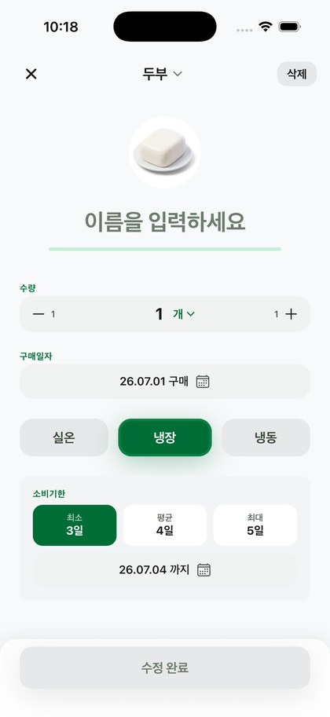 | 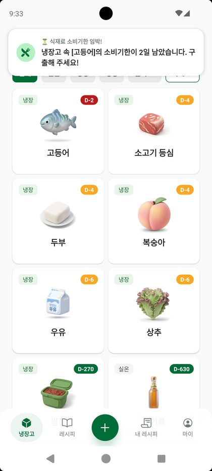 |

## AI 레시피와 조리 흐름

| 추천 카드 | 조리법 확인 | 레시피 목록 | 레시피 상세 |
| --- | --- | --- | --- |
| 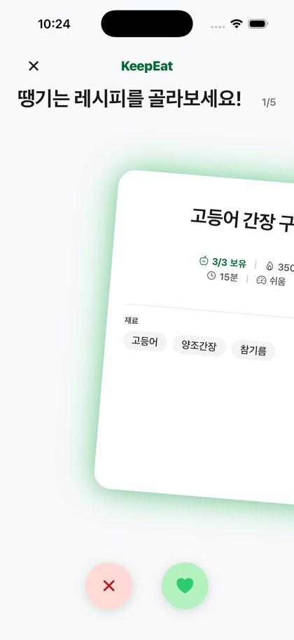 | 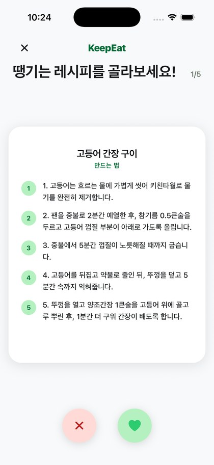 | 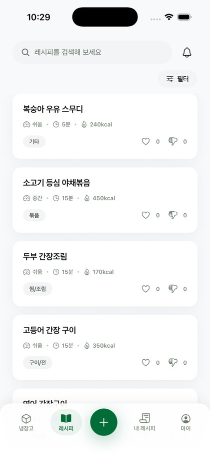 | 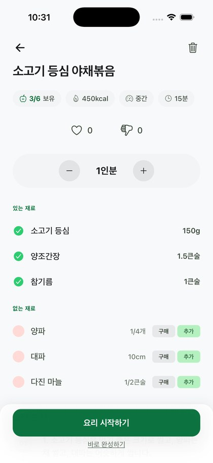 |

| 레시피 필터 | 요리 준비 | 조리 단계 | 요리 완료 |
| --- | --- | --- | --- |
| 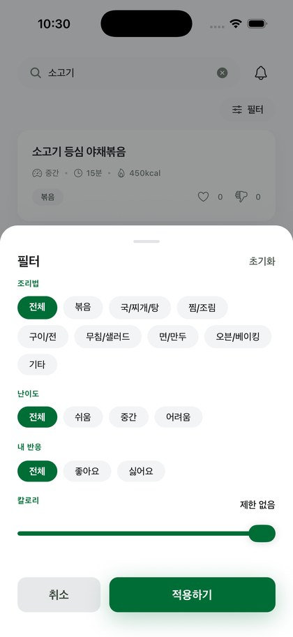 | 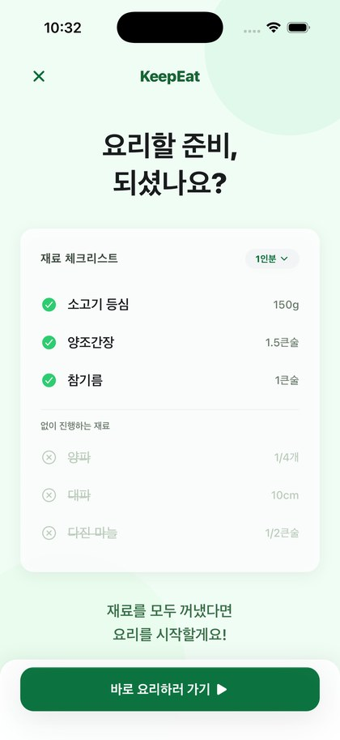 | 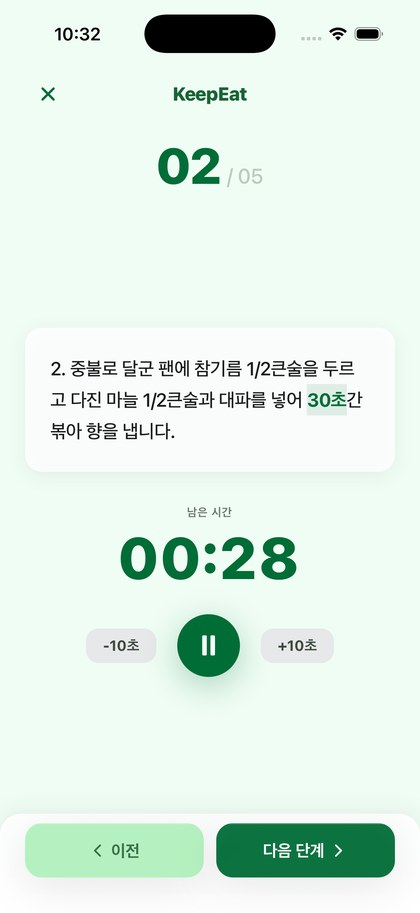 | 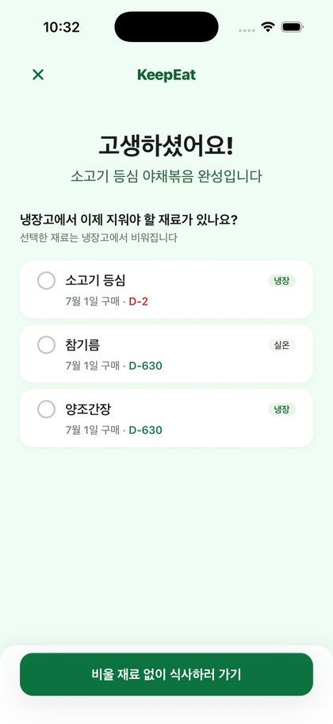 |

## 팀 구성

| 이름 | 담당 |
| --- | --- |
| 이선용 | 프론트엔드 단독: 화면·상태 설계, API 연동, 디자인 시스템, QA·검증 자동화 |
| 최한기 | 식재료 소비기한 |
| 김지성 | 알림·로그인 |
| 방경환 | AI 맞춤 레시피 |

## 기술 스택

| 영역 | 기술 |
| --- | --- |
| 모바일 앱 | React Native, Expo |
| 언어 | TypeScript |
| 라우팅 | Expo Router |
| 상태 관리 | React Context, 화면 로컬 상태 |
| 네트워크 | REST API, Axios, multipart fetch |
| 저장소 | AsyncStorage, Expo SecureStore |
| 검증 | npm verify, Maestro |

## 앱 Variant와 API 환경

production 앱은 기존 식별자(`KeepEat`, `keepeat`, `com.anonymous.keepeatfront`,
`com.anonymous.keepeat_front`)를 유지합니다. development/demo 빌드는 demo
variant로 생성되며 이름과 scheme, iOS/Android 식별자에 `Demo` 또는 `.demo`가
붙습니다. 두 variant는 서로 다른 앱 샌드박스를 사용하므로 SecureStore 데이터도
분리됩니다.

로컬 Metro 실행은 `.env`의 실행 환경별 API URL을 사용합니다. 선택된 값은 앱이
읽는 `EXPO_PUBLIC_API_URL`로 주입됩니다. `.env`는 Git에서 무시됩니다.

```dotenv
# .env
EXPO_PUBLIC_API_URL_LOCAL=http://localhost:8080
EXPO_PUBLIC_API_URL_DEMO=<demo-api-url>
```

```bash
npm run start:local # EXPO_PUBLIC_API_URL_LOCAL 사용
npm run start:demo  # EXPO_PUBLIC_API_URL_DEMO 사용
```

EAS 클라우드 빌드는 Git에서 제외된 로컬 env 파일을 읽지 않습니다. EAS의 내장
`preview` Environment에는 demo API 주소를, `production` Environment에는
production API 주소를 같은 이름의 `EXPO_PUBLIC_API_URL`로 등록합니다. 여기서
`preview`는 EAS 원격 변수 저장소 이름일 뿐, Build profile과 Update channel은
`demo`입니다. EAS Update에서도 app config가 같은 환경을 해석하도록
`APP_ENV=demo` 또는 `APP_ENV=prod`를 함께 등록합니다.

```bash
eas env:create --name EXPO_PUBLIC_API_URL --value <demo-api-url> --environment preview --visibility plaintext
eas env:create --name APP_ENV --value demo --environment preview --visibility plaintext
eas env:create --name EXPO_PUBLIC_API_URL --value <production-api-url> --environment production --visibility plaintext
eas env:create --name APP_ENV --value prod --environment production --visibility plaintext
```

Build와 Update는 profile/channel에 대응하는 Environment를 함께 사용합니다.

```bash
eas build --profile development
eas build --profile demo
eas build --profile production

eas update --channel demo --environment preview
eas update --channel production --environment production
```

Android demo 빌드는 `.demo` package로 등록한 별도 Firebase 설정 파일이 필요합니다.
EAS `preview` Environment에 파일 변수 `GOOGLE_SERVICES_JSON`을 등록하면 동적 app
config가 해당 파일을 사용합니다. EAS Update는 demo/production channel과
variant별 runtimeVersion으로 분리합니다.

## 프론트엔드 구현 범위

| 영역 | 내용 |
| --- | --- |
| 화면·상태 설계 | Expo Router 기반 탭/스택 화면 구성, 인증 게이트, 화면별 로컬 상태와 Context 조합 |
| API 연동 | 인증, 식재료, OCR, 레시피, 알림 API 래퍼와 DTO 매핑 |
| 식재료 등록 UX | 수동 입력, 영수증 OCR 결과 확인, 보관방법별 소비기한 제안, 직접 입력 재료 처리 |
| 냉장고 관리 | 소비기한 기준 정렬, 검색, 보관 방식 필터, 카테고리 필터, 상세 수정, 다중 삭제 |
| AI 레시피 | 추천 요청 상태, 완료 알림, 스와이프 저장, 레시피 상세와 조리 모드 연결 |
| 디자인 시스템 | 디자인 토큰과 공통 컴포넌트 기반 UI 일관성 관리 |
| QA·검증 | `npm run verify`, Maestro YAML 기반 핵심 플로우 검증 |

## 디자인 시스템과 공통 컴포넌트

| 경로 | 설명 |
| --- | --- |
| `constants/theme.ts` | 색상, 타이포그래피, 간격, radius, shadow, feedback, glass surface 토큰 |
| `components/` | 헤더, 모달, 바텀시트, 카드, 토스트, 입력 컴포넌트 등 공통 컴포넌트 27개 |
| `components/ConfirmModal.tsx` | 삭제, 취소, 탈퇴, 권한 안내 등 여러 화면에서 재사용하는 확인 모달 |
| `components/Toast.tsx` | `ToastProvider`와 `useToast()` 기반 전역 피드백 및 인앱 알림 드롭다운 |
| `components/RecipeFilterSheet.tsx` | 공용 레시피와 내 레시피 화면에서 공유하는 레시피 필터 바텀시트 |

## 상태 관리와 API 경계

전역 상태는 별도 상태 관리 라이브러리 없이 React Context 중심으로 구성했습니다. 인증, 알림, 식재료 마스터, AI 추천처럼 여러 화면에서 공유되는 상태는 Context로 분리하고, 검색어·필터·입력값처럼 화면에 종속된 상태는 로컬 state로 관리했습니다.

| Context | 역할 |
| --- | --- |
| `AuthContext` | 로그인 상태, 사용자 정보, 토큰 기반 부팅 복구 |
| `NotificationContext` | 알림 목록, 읽음 처리, unread count, 푸시 탭 라우팅 |
| `IngredientMasterContext` | 서버·캐시·로컬 seed 기반 식재료 마스터 데이터 |
| `RecipeRecommendationContext` | AI 추천 요청 상태, 추천 결과, 스와이프 저장 상태 |

API 통신은 `services/` 계층에 모아 화면 컴포넌트가 서버 DTO에 직접 의존하지 않도록 분리했습니다.

## AI 작업 컨텍스트와 검증

AI 코딩 도구가 필요한 맥락만 참조할 수 있도록 `AGENTS.md`를 진입점으로 두고, 도메인 규칙·사용자 흐름·프론트엔드 공통 규칙·검증 문서를 `docs/` 아래에 계층화했습니다.

| 경로 | 설명 |
| --- | --- |
| `AGENTS.md` | AI 작업 규칙 진입점 |
| `ARCHITECTURE.md` | 앱 구조, 라우팅, Provider, API 경계 요약 |
| `docs/` | 계층화 문서 17개 |
| `docs/frontend/design-system.md` | 디자인 토큰과 공통 UI 규칙 |
| `docs/quality/verification.md` | 정적 검증과 수동 확인 시나리오 |
| `.maestro/login.yaml` | 로그인 검증 플로우 |
| `.maestro/ingredient-add-manual.yaml` | 식재료 수동 추가 검증 플로우 |
| `.maestro/cooking-flow.yaml` | 조리 플로우 검증 YAML |

## 핵심 경로

| 경로 | 설명 |
| --- | --- |
| `app/` | Expo Router 기반 화면 라우트 |
| `app/(tabs)/index.tsx` | 냉장고 홈 |
| `app/(tabs)/explore.tsx` | 공용 레시피 탐색 |
| `app/(tabs)/recipe.tsx` | 내 레시피 |
| `app/add-confirm.tsx` | 식재료 등록 확인 |
| `app/crop.tsx` | 영수증 OCR 영역 선택 |
| `app/recipe-swipe.tsx` | AI 추천 레시피 스와이프 |
| `app/cooking-ready.tsx`, `app/cooking-step.tsx`, `app/cooking-complete.tsx` | 조리 모드 |
| `context/` | 인증, 알림, 식재료 마스터, AI 추천 Context |
| `services/` | API 클라이언트와 도메인별 서비스 래퍼 |

## 브랜치 안내

프론트엔드는 `front` 브랜치에서 개발 중인 진행 중 프로젝트입니다.
